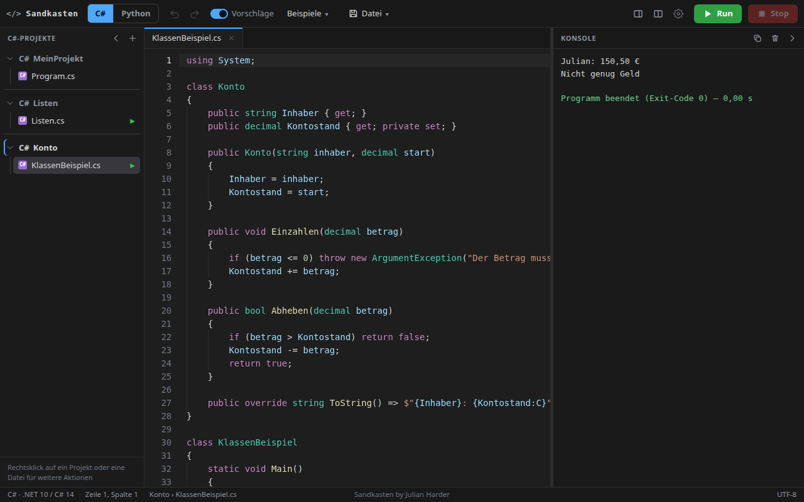
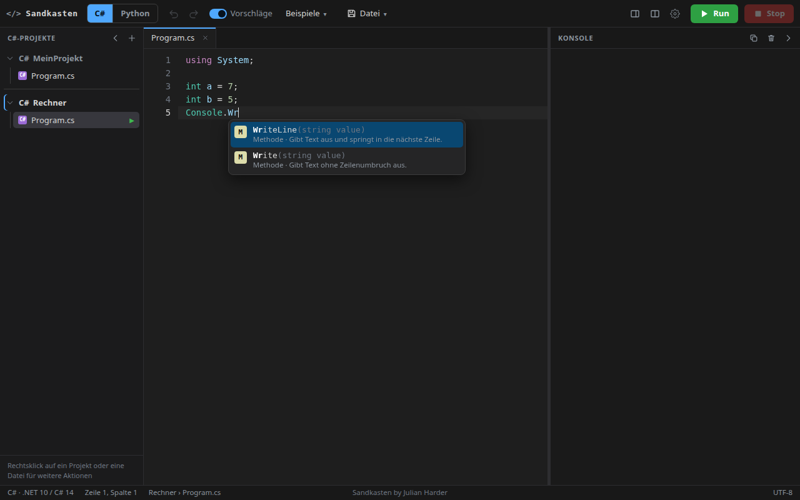
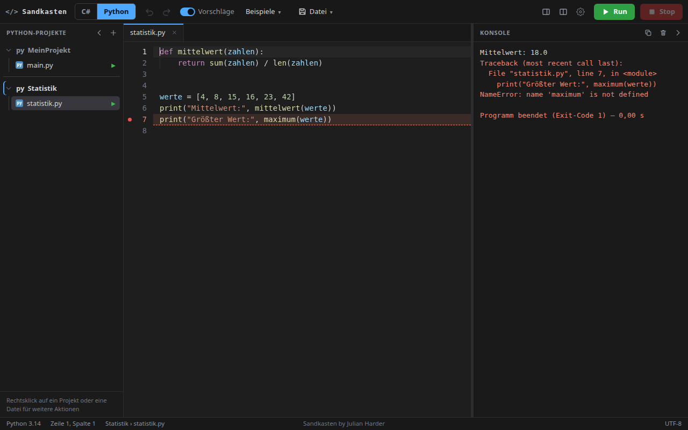
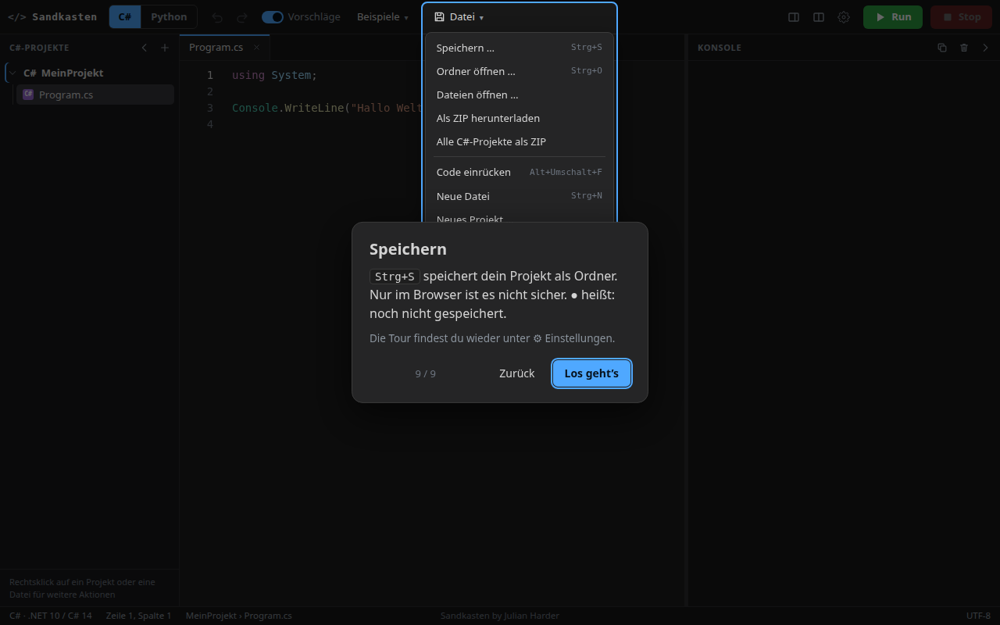

# Sandkasten-Code-Editor

**Sandkasten – by Julian Harder**

Ein Editor im Browser, in dem man **Konsolenprogramme in C# und Python**
schreibt und sofort startet. Ohne Installation, ohne Server, ohne Anmeldung.



Der Editor führt die Programme nicht über einen Server aus, sondern mit zwei
selbst geschriebenen Interpretern direkt in der Seite. Alles läuft lokal, und
die Seite lädt **nichts** aus dem Netz: kein CDN, keine Bibliotheken.

## Was man tun kann

**Schreiben und starten.** Zeilennummern, Syntax-Farben, automatische
Einrückung, Klammern, die sich von selbst schließen, Suchen & Ersetzen. Ein
Klick auf **Run** (oder `F5`) startet das Programm, die Ausgabe erscheint in
der Konsole. Fragt das Programm etwas ab (`Console.ReadLine()` oder `input()`),
tippt man die Antwort direkt in die Konsole. **Stop** bricht jedes Programm ab,
auch eine Endlosschleife.

**Vorschläge beim Tippen.** Der Editor kennt die eingebauten Befehle von C# und
Python und dazu die Klassen, Methoden und Variablen des eigenen Projekts. Jeder
Vorschlag zeigt Art, Signatur und eine kurze Beschreibung.



**Fehler, die man versteht.** C# meldet Fehler mit Datei, Zeile, Spalte und
Fehlercode (`Program.cs(7,30): error CS1002: ; erwartet`), Python mit
`SyntaxError` und `Traceback`. Ein Klick auf die Meldung springt zur Zeile,
und die Zeile wird rot markiert.



**Mehrere Projekte.** Zu jeder Sprache gibt es beliebig viele Projekte, die in
der Seitenleiste untereinander stehen. C# und Python bleiben dabei getrennt:
Die Seitenleiste zeigt immer nur die Projekte der gewählten Sprache. Ein
Programm läuft weiter, auch wenn man in ein anderes Projekt wechselt.

**Speichern, ohne etwas zu verlieren.** Der Browser merkt sich alles
automatisch. Richtig gesichert wird in einen Ordner auf dem Rechner
(`Strg+S`) oder als ZIP. Ein Punkt ● zeigt, was noch nicht gesichert ist, und
beim Schließen des Tabs warnt der Browser davor.

**Eine kurze Tour beim ersten Öffnen.** Sie zeigt in neun Schritten die
wichtigsten Stellen und lässt sich jederzeit überspringen.



## Starten

`index.html` doppelklicken. Kein Server, kein Build, keine Installation.
Gebraucht wird ein aktueller Browser (Chrome, Edge, Firefox oder Safari).

Nur **Chrome und Edge** können einen Ordner direkt beschreiben. In den anderen
Browsern lädt „Speichern“ stattdessen eine ZIP-Datei herunter, alles andere
funktioniert gleich.

## So benutzt du ihn

1. **Sprache wählen.** Oben links zwischen **C#** und **Python** umschalten.
2. **Ausprobieren.** Im Menü **Beispiele** liegen je Sprache zehn kleine
   Programme (Hello World, Taschenrechner, Zahlenraten, Klassen,
   Fehlerbehandlung, mehrere Dateien …). Ein Klick lädt das Beispiel in das
   aktuelle Projekt.
3. **Starten.** **Run** oder `F5` (auch `Strg+Enter`). Die Konsole öffnet sich
   von selbst.
4. **Eingaben.** Wartet das Programm auf eine Eingabe, tippst du sie in die
   Konsole und drückst `Enter`. Mit Pfeil hoch/runter holst du frühere
   Eingaben zurück.
5. **Eigenes Projekt.** In der Seitenleiste auf **+** klicken (oder
   *Datei → Neues Projekt …*), einen Namen eingeben, fertig. Dateien kommen mit
   Rechtsklick auf das Projekt oder mit `Strg+N` dazu.
6. **Speichern.** `Strg+S` fragt nach einem Ordnernamen und einem Speicherort
   und legt alle Dateien des Projekts dort ab. Danach speichert `Strg+S` direkt
   in diesen Ordner. *Datei → Alle Projekte als ZIP* packt alle Projekte der
   Sprache auf einmal ein.
7. **Wieder öffnen.** *Datei → Ordner öffnen* oder einfach einen Ordner oder
   Dateien ins Fenster ziehen. Der Editor fragt, ob das Projekt **hinzugefügt**
   oder ein bestehendes **ersetzt** werden soll.
8. **Anpassen.** Das Zahnrad ⚙ öffnet die Einstellungen: Schriftgröße,
   Tab-Breite, Zahlenformat in C# (`3,14` oder `3.14`), Vorschläge an/aus und
   die Warnung beim Schließen.

Die Tour vom Start steht im Zahnrad-Menü unter „Einführung nochmal ansehen“
wieder bereit.

## Bedienung

| Kürzel | Aktion |
|---|---|
| `F5` oder `Strg+Enter` / `Umschalt+F5` | Run / Stop |
| `Strg+S` | Speichern |
| `Strg+O` | Ordner öffnen |
| `Strg+N` (oder `Alt+N`) | Neue Datei – `Strg+N` reservieren manche Browser für neue Fenster |
| `Strg+Z` / `Strg+Y` (`Strg+Umschalt+Z`) | Rückgängig / Wiederholen |
| `Strg+Leertaste` | Vorschläge manuell öffnen |
| `Strg+/` | Zeile(n) auskommentieren |
| `Strg+G` | Zu Zeile springen (`12` oder `12:5` für Zeile:Spalte) |
| `Strg++` / `Strg+-` / `Strg+0` | Schrift größer / kleiner / Standard (auch `Strg+Mausrad`) |
| `Strg+F` / `Strg+H` | Suchen / Ersetzen |
| `Strg+D` | Zeile duplizieren |
| `Alt+Umschalt+F` | Code einrücken (C#: ganzes Dokument oder Markierung) |
| `Alt+↑` / `Alt+↓` | Zeile verschieben |
| `Tab` / `Umschalt+Tab` | Einrücken / Ausrücken |
| `Strg+J` | Konsole ein-/ausklappen |
| `Strg+Tab` | Nächster Datei-Tab (viele Browser fangen das selbst ab) |

Weiteres, das man nicht sofort sieht:

- Die Klammer neben dem Cursor und ihr Gegenstück werden hervorgehoben,
  dünne Linien zeigen, welche Zeilen zu einem Block gehören.
- Eingefügter Code wird automatisch passend eingerückt (abschaltbar).
- Tabs lassen sich mit der Maus umsortieren. Die geteilte Ansicht zeigt zwei
  Dateien nebeneinander.
- Die Konsole liegt rechts oder unten, der Trennbalken ist ziehbar, die Ausgabe
  lässt sich mit einem Klick kopieren.
- Rechtsklick auf ein Projekt oder eine Datei: umbenennen, löschen, als
  Startdatei festlegen, im zweiten Fenster öffnen.

## Was die Sprachen können

### C#
Top-Level-Statements **und** `class Program { static void Main() }`. Die
üblichen Datentypen, Klassen, Strukturen, Records, Enums, Schnittstellen,
abstrakte Klassen, Vererbung (`virtual`/`override`/`base`), Eigenschaften,
Indexer, Operatoren, Generics (die Typen werden nicht geprüft), Delegaten,
Lambdas, Ereignisse, Erweiterungsmethoden, `switch` mit Mustern,
`try/catch/finally`, Tupel, `ref`/`out`/`params`, optionale und benannte
Argumente, lokale Funktionen.

Bibliothek: `Console`, `Math`, `Convert`, `string`, `StringBuilder`, `List<T>`,
`Dictionary`, `HashSet`, `Queue`, `Stack`, Arrays (auch mehrdimensional),
`Random`, `DateTime`, `TimeSpan`, `Stopwatch`, `Enum`, LINQ (`Where`, `Select`,
`OrderBy`, `GroupBy`, `Sum` …) und Ausnahmeklassen mit deutschen Meldungen.

Vor dem Start prüft ein statischer Check typische Fehler: unbekannte Namen
(`CS0103`), falsche Typen (`CS0029`/`CS0266`), fehlende Rückgabe (`CS0161`),
doppelte Variablen und einige mehr.

### Python
`print`, `input`, Rechnen, `if/elif/else`, `for`, `while` (mit `else`),
Listen, Dictionaries, Mengen, Tupel, Slicing, Comprehensions, Funktionen
(Standardwerte, `*args`, `**kwargs`, `lambda`), Closures, `global`/`nonlocal`,
Klassen mit Vererbung und `super()`, Eigenschaften, Dunder-Methoden,
**Generatoren (`yield`)**, `try/except/finally`, `raise`, `with`, f-Strings,
String-Methoden und `import` eigener Dateien.

Module: `math`, `random`, `time`, `sys`, `string`, `copy`, `functools`,
`itertools`, `collections`, `statistics`, `typing`, `abc`, `json`, `datetime`
(Teilmenge).

### Bewusst nicht enthalten
Hier gibt es eine **klare Meldung** statt stillem Fehlverhalten: `async/await`,
Threads und Tasks, `goto`, Dateizugriff (`File`, `open`), `eval`/`exec`,
`match` (Python), komplexe Zahlen und Bytes.

## Wie es funktioniert

C# und Python werden von selbst geschriebenen Interpretern ausgeführt: Lexer,
Parser, Interpreter, alles in JavaScript. Die Interpreter sind **Generatoren**,
die ein Runner (`js/runtime/common.js`) in kleinen Zeitscheiben mit einem
eigenen Aufrufstapel antreibt. Deshalb geht, was sonst in einer Browserseite
schwierig ist:

- **Stop** greift auch bei `while (true)`, ohne dass die Seite einfriert.
- **Eingaben** (`ReadLine()`, `input()`) halten das Programm an, bis du
  `Enter` drückst.
- **Tiefe Rekursion** hängt nicht vom Stack des Browsers ab.

Die Fehlermeldungen entsprechen den echten Meldungen in Fehlercode und Sinn;
der Wortlaut ist teils vereinfacht.

**Zahlenformat in C#.** Standard ist **Deutsch**, wie auf einem deutschen
Rechner mit `dotnet run`: `Console.WriteLine(3.14)` gibt `3,14` aus,
`double.Parse("3,14")` liest `3,14`, `{x:C}` zeigt `€`. In den Einstellungen
lässt sich auf **Englisch** (`3.14`) umschalten. Python gibt Zahlen immer mit
Punkt aus.

## Bekannte Grenzen

- Die Interpreter sind für Lernprogramme gebaut, nicht für Rechenleistung:
  rund 0,3–1 Millionen einfache Schleifendurchläufe pro Sekunde.
- C# meldet beim Kompilieren nur Fehler, die der Check sicher erkennt; alles
  Weitere erscheint zur Laufzeit.
- Strukturen haben Wertsemantik nur bei Zuweisung und Parameterübergabe.
  `Random` liefert andere Zahlenfolgen als .NET, auch mit festem Startwert.
- Browser-Kürzel wie `Strg+N`, `Strg+Tab` oder `Strg+O` lassen sich je nach
  Browser nicht abfangen.
- Es gibt nur den Dark Mode.
- Der Editor ist für den Desktop gemacht. Auf dem Handy ist er nicht
  brauchbar. Eine **Handy-Version** ist geplant.

## Aufbau

```
code-editor/
├── index.html                 ← per Doppelklick starten
├── css/style.css              ← Dark-Theme, Layout
├── js/
│   ├── main.js                ← verbindet alles
│   ├── editor/                ← Editor, Syntax-Farben, Vorschläge, Verlauf
│   ├── layout/splitter.js     ← Trennbalken
│   ├── files/                 ← Projekte, Speichern, ZIP
│   ├── runtime/
│   │   ├── common.js          ← Runner (Zeitscheiben, Eingabe, Stop)
│   │   ├── console.js         ← Ausgabe, Eingabefeld, klickbare Fehler
│   │   ├── python/            ← lexer, parser, objects, builtins, interpreter
│   │   └── csharp/            ← lexer, parser, objects, interpreter, library, check
│   └── data/                  ← API-Listen für die Vorschläge, Beispiele
├── screenshots/               ← Bilder für diese README
└── tests/                     ← Node-Tests (für den Betrieb nicht nötig)
```

Alle JavaScript-Dateien sind normale `<script>`-Tags (keine ES-Module, kein
`fetch`), damit alles über `file://` läuft. **Die Reihenfolge der Tags in
`index.html` zählt**: Code, der beim Laden sofort läuft, braucht die
Funktionen aus früher geladenen Dateien. Neue Dateien daher passend
einsortieren.

## Tests

```bash
node tests/run-all.js
```

Das führt die Python-Tests (34), die C#-Tests (22), alle Beispiele beider
Sprachen, die Projektverwaltung (16) und eine ZIP-Prüfung (`unzip -t`) aus.
Dafür wird Node.js gebraucht, im Browser genügt der Doppelklick.

## Bausteine

Keine. Der Editor, die Syntax-Farben, die Vorschläge, beide Interpreter und
der ZIP-Schreiber sind selbst geschrieben; es gibt keine Bibliothek und keine
Schrift aus dem Netz.

---

Erstellt mit Unterstützung von KI (Claude).
